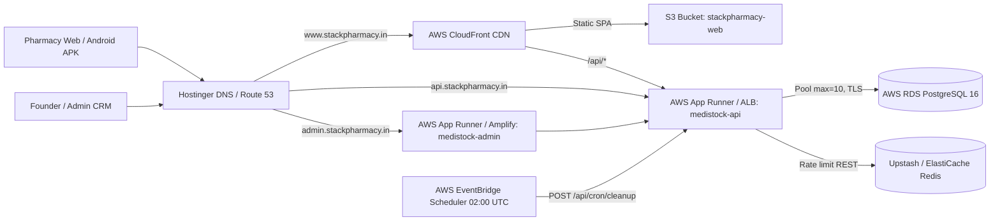

# StackPharmacy — AWS Migration Guide (`ap-south-1` Mumbai)

> **Goal:** Zero-downtime migration from **Vercel + Supabase + Upstash** to **AWS (`ap-south-1` Mumbai)** with an instant 48-hour DNS rollback path.

---

## 1. Target Architecture



### Why this architecture fits StackPharmacy
- **No 10s–25s serverless timeouts:** Persistent Node container (`server/server.js`) handles 30s+ AI invoice scans reliably.
- **Keep-alive proxy safety:** `server/server.js` sets `keepAliveTimeout = 65000` and `headersTimeout = 66000` (> AWS 60s idle timeout) to prevent `502 Bad Gateway`.
- **Same-origin API routing on CloudFront:** Routing `/api/*` on CloudFront to the backend eliminates CORS preflight overhead and keeps WhatsApp PDF links (`https://www.stackpharmacy.in/api/public/invoice/...`) working seamlessly.
- **No vendor lock-in in Auth:** Sessions are standard PostgreSQL rows (`sessions`) with `scrypt` password hashes — zero dependency on Supabase Auth.

---

## 2. IAM Prerequisites

> Your current local AWS profile (`smartnest-deploy` in `ap-south-1`) only has permissions for `smartnest-db` (RDS) and `smartnest-api` (App Runner). S3, EC2, ECS, and Amplify actions returned `AccessDenied`.

Create a dedicated IAM user/role (e.g., `stackpharmacy-deploy`) or attach policies for:
- `AmazonRDSFullAccess` (or scoped RDS DB instance + parameter group)
- `AWSAppRunnerFullAccess` + `AmazonEC2ContainerRegistryPowerUser`
- `AmazonS3FullAccess` (for `stackpharmacy-web` and DB backups)
- `CloudFrontFullAccess` + `AWSCertificateManagerFullAccess` (note: CloudFront ACM certificates must be created in `us-east-1`)
- `AmazonEventBridgeSchedulerFullAccess`
- `SecretsManagerReadWrite` (or SSM Parameter Store)

---

## 3. Phase-by-Phase Execution Checklist

### Phase A — Database Migration (Supabase ➔ AWS RDS PostgreSQL `ap-south-1`)

1. **Provision RDS PostgreSQL 16 (`ap-south-1`):**
   - Instance class: `db.t4g.micro` or `db.t3.micro` (20 GB GP3 storage, automated backups enabled, 7–30 day retention).
   - Security Group: Allow TCP `5432` from the backend App Runner VPC Connector / EC2 security group (and temporarily your IP for initial import, then restrict).
   - Download the AWS RDS CA bundle:
     ```bash
     curl -o certs/global-bundle.pem https://truststore.pki.rds.amazonaws.com/global-bundle.pem
     ```

2. **Take clean consistent backup from Supabase (use direct connection port `5432`, NOT pooler `6543`):**
   ```bash
   pg_dump "$SUPABASE_DIRECT_URL" \
     --no-owner --no-privileges --clean --if-exists \
     -Fc -f stackpharmacy_migration.dump
   ```

3. **Restore to AWS RDS:**
   ```bash
   createdb -h <rds-endpoint> -U postgres stackpharmacy
   pg_restore -h <rds-endpoint> -U postgres -d stackpharmacy \
     --no-owner --no-privileges --clean --if-exists \
     stackpharmacy_migration.dump
   ```

4. **Reconcile Row Counts (Gate before switching traffic):**
   Run on both Supabase and RDS and verify exact parity:
   ```sql
   SELECT 'tenants' AS tbl, COUNT(*) FROM tenants
   UNION ALL SELECT 'users', COUNT(*) FROM users
   UNION ALL SELECT 'medicines', COUNT(*) FROM medicines
   UNION ALL SELECT 'batches', COUNT(*) FROM batches
   UNION ALL SELECT 'sales', COUNT(*) FROM sales
   UNION ALL SELECT 'purchases', COUNT(*) FROM purchases
   UNION ALL SELECT 'customers', COUNT(*) FROM customers
   UNION ALL SELECT 'customer_ledger', COUNT(*) FROM customer_ledger
   UNION ALL SELECT 'tenant_payments', COUNT(*) FROM tenant_payments;
   ```

---

### Phase B — Backend Deployment (`server/Dockerfile` ➔ ECR + AWS App Runner)

1. **Create ECR repository & push image (`ap-south-1`):**
   ```bash
   aws ecr create-repository --repository-name stackpharmacy-api --region ap-south-1
   aws ecr get-login-password --region ap-south-1 | docker login --username AWS --password-stdin <ACCOUNT_ID>.dkr.ecr.ap-south-1.amazonaws.com
   docker build -t stackpharmacy-api ./server
   docker tag stackpharmacy-api:latest <ACCOUNT_ID>.dkr.ecr.ap-south-1.amazonaws.com/stackpharmacy-api:latest
   docker push <ACCOUNT_ID>.dkr.ecr.ap-south-1.amazonaws.com/stackpharmacy-api:latest
   ```

2. **Required Environment Variables / Secrets Manager:**
   - `NODE_ENV=production`
   - `PORT=3001`
   - `DATABASE_URL=postgresql://postgres:<PASS>@<RDS_ENDPOINT>:5432/stackpharmacy`
   - `DATABASE_POOL_MAX=10` (auto-defaults to `10` when `VERCEL` env is absent)
   - `DATABASE_SSL_MODE=verify` + `DATABASE_SSL_CA` (contents or container path of `global-bundle.pem`)
   - `INVOICE_SHARE_SECRET=<EXACT_CURRENT_SECRET>` *(MUST match current Vercel value so existing customer invoice links remain valid)*
   - `RAZORPAY_KEY_ID`, `RAZORPAY_KEY_SECRET`, `RAZORPAY_WEBHOOK_SECRET`
   - `NVIDIA_API_KEY`, `GEMINI_API_KEY`, `SENTRY_DSN`, `CRON_SECRET`
   - `UPSTASH_REDIS_REST_URL`, `UPSTASH_REDIS_REST_TOKEN` (keep working Day 1; optional later move to AWS ElastiCache)
   - `CORS_ORIGINS=https://<CLOUDFRONT_DOMAIN>,https://<ADMIN_AWS_URL>` (during parallel staging test before DNS cutover)

3. **Health Check & Daily Cleanup Cron:**
   - App Runner Health Check Path: `/api/health` (Port `3001`).
   - Create an **AWS EventBridge Scheduler** daily cron (`cron(0 2 * * ? *)` UTC):
     - Target: `POST https://api.stackpharmacy.in/api/cron/cleanup`
     - Header: `Authorization: Bearer <CRON_SECRET>`

---

### Phase C — Frontend (`client/`) ➔ S3 + CloudFront

1. **Build client cleanly (ensure no stale local `client/.env.production` overrides `VITE_API_BASE`):**
   ```bash
   cd client && npm ci && npm run build
   ```
   *(If hosting WITHOUT CloudFront `/api/*` routing, pass `VITE_WEB_API_BASE=https://api.stackpharmacy.in npm run build`.)*

2. **Upload to S3 with proper cache headers:**
   ```bash
   aws s3 sync client/dist/assets s3://stackpharmacy-web/assets --cache-control "public,max-age=31536000,immutable" --delete
   aws s3 sync client/dist s3://stackpharmacy-web --exclude "assets/*" --cache-control "public,max-age=0,must-revalidate" --delete
   ```

3. **CloudFront Distribution Settings:**
   - **Origin 1:** S3 (`stackpharmacy-web`) via Origin Access Control (OAC).
   - **Origin 2:** App Runner service domain (`<service>.ap-south-1.awsapprunner.com`).
   - **Behavior 1 (`/api/*`):** Forward to Origin 2, Cache Policy `CachingDisabled`, Origin Request Policy `AllViewerExceptHostHeader` (preserves `Authorization`, `Origin`, `X-Forwarded-For`).
   - **Default Behavior (`*`):** S3 Origin 1.
   - **Custom Error Responses (for React Router SPA):** Map HTTP `403` and `404` ➔ `/index.html` with response code `200`.

---

### Phase D — Admin CRM (`medistock-admin/Dockerfile`)

1. **Build & Push Admin Container:**
   ```bash
   docker build --build-arg NEXT_PUBLIC_API_URL=https://api.stackpharmacy.in -t stackpharmacy-admin ../medistock-admin
   ```
2. **Deploy to App Runner (Port `3002`, Health Check `/api/health`):**
   - Env vars: `NEXTAUTH_URL=https://admin.stackpharmacy.in`, `NEXTAUTH_SECRET=<strong-random-secret>`, `NEXT_PUBLIC_API_URL=https://api.stackpharmacy.in`.

---

## 4. Zero-Downtime Cutover & 48h Rollback Plan

### Cutover Steps
1. Verify all endpoints, login, billing, AI bill scanner, and WhatsApp PDF links on the staging CloudFront/App Runner URLs.
2. Put Vercel maintenance banner or 2-minute write-pause ➔ run final delta `pg_dump` / `pg_restore` into RDS so zero transactions are lost.
3. Update Hostinger DNS records (set TTL to `300` beforehand):
   - `www` CNAME ➔ CloudFront domain (`dxxxx.cloudfront.net`)
   - `api` CNAME ➔ App Runner custom domain target (`xxx.ap-south-1.awsapprunner.com`)
   - `admin` CNAME ➔ Admin App Runner target
4. Update Razorpay webhook URL (if changed) & GitHub Actions secret `DATABASE_DIRECT_URL` (for [.github/workflows/backup.yml](../.github/workflows/backup.yml)).

### Instant Rollback (< 5 minutes)
- Keep Vercel deployments (`medistock-app`, `medistock-api`, `medistock-admin`) untouched for 48 hours.
- If any severe regression occurs, switch Hostinger DNS CNAME records back to Vercel (`915110db6c59559f.vercel-dns-017.com` / `cname.vercel-dns.com`).
